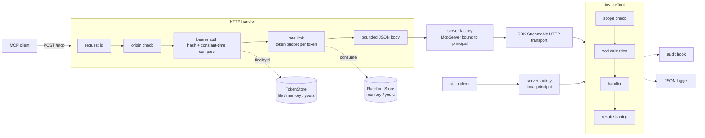

# mcp-kit

[](https://github.com/mayank-urnextdoor/mcp-kit/actions/workflows/ci.yml)
[](LICENSE)

A small TypeScript framework for building [Model Context Protocol](https://modelcontextprotocol.io) servers that are safe to put on a network.

The official [`@modelcontextprotocol/sdk`](https://www.npmjs.com/package/@modelcontextprotocol/sdk) gives you the protocol and the transports. It leaves out everything around them: who is calling, what they may do, how often, and what happened. Every MCP server that leaves `localhost` ends up writing that layer. mcp-kit is that layer, kept small enough to read in one sitting (roughly 1,000 lines of non-comment code in `src/`).

## Features

- **Scoped bearer tokens.** Tokens look like `mcpk_<id>_<secret>`. Only a SHA-256 hash is stored, lookup is by the public id, and comparison is constant time. Each token has a set of scopes (`read`, `write`, or your own).
- **Scope-aware tools.** `tools/list` only shows a caller the tools its token can use. `tools/call` checks the scope again before anything runs.
- **`defineTool()`.** A zod schema, a required scope and a typed handler. Input is validated, defaults are applied, and failures come back as structured errors with field paths.
- **Per-token rate limiting.** A token bucket with a pluggable store interface. The default store is in-memory. Requests over the limit get `429` with `Retry-After`.
- **Structured logs and audit events.** JSON lines on stderr, request ids that you can pass in with `X-Request-Id`, redaction of secret-looking fields, and one audit event per tool call through a hook you can replace.
- **Both transports.** Streamable HTTP (stateless) for remote clients and stdio for local ones, running the same tools.
- **Token CLI.** Mint, list and revoke tokens. The plaintext is printed once.
- **Example server.** Notes CRUD over an in-memory store, with client configs for Claude Code and Claude Desktop.

## Quickstart

Requires Node.js 22.13 or later. `npm ci` stops with an `EBADENGINE` error on older versions.

```bash
git clone https://github.com/mayank-urnextdoor/mcp-kit.git
cd mcp-kit
npm ci

# Mint a token. The hash goes to ./data/tokens.json; the token prints once on stdout.
npm run tokens -- mint --name my-laptop --scopes read,write

# Start the example notes server on http://127.0.0.1:3000/mcp
npm run dev
```

The server logs the URL it listens on. If `PORT` is already set in your shell, that port is used instead of 3000. To capture only the token (for a script or a secret manager), add `-s`: `npm run -s tokens -- mint ...`. Without it, npm prints its script banner to stdout too.

Other token commands: `npm run tokens -- list` and `npm run tokens -- revoke <id>`. Mint with `--expires-in-days N` for a token that expires.

Try it with curl:

```bash
export MCP_KIT_TOKEN=mcpk_...   # the value printed above

curl -s http://127.0.0.1:3000/mcp \
  -H "Authorization: Bearer $MCP_KIT_TOKEN" \
  -H "Content-Type: application/json" \
  -H "Accept: application/json, text/event-stream" \
  -d '{"jsonrpc":"2.0","id":1,"method":"tools/call","params":{"name":"create_note","arguments":{"title":"hello"}}}'
```

On Windows PowerShell, `curl` is an alias for `Invoke-WebRequest` and the line continuations above do not work. Use this instead:

```powershell
$env:MCP_KIT_TOKEN = "mcpk_..."
$body = '{"jsonrpc":"2.0","id":1,"method":"tools/call","params":{"name":"create_note","arguments":{"title":"hello"}}}'
Invoke-RestMethod http://127.0.0.1:3000/mcp -Method Post -Body $body -ContentType "application/json" `
  -Headers @{ Authorization = "Bearer $env:MCP_KIT_TOKEN"; Accept = "application/json, text/event-stream" }
```

Or point the [MCP Inspector](https://github.com/modelcontextprotocol/inspector) CLI at it:

```bash
npx @modelcontextprotocol/inspector --cli http://127.0.0.1:3000/mcp --transport http   --header "Authorization: Bearer $MCP_KIT_TOKEN" --method tools/list
```

To run the compiled build instead of `tsx`: `npm run build`, then `npm start` (HTTP) or `node dist/examples/notes-server/main.js --stdio`.

### Connect a client

**Claude Code (HTTP).** From any directory:

```bash
claude mcp add --transport http mcp-kit-notes http://127.0.0.1:3000/mcp \
  --header "Authorization: Bearer $MCP_KIT_TOKEN"
```

Or commit [`examples/client-config/claude-code.mcp.json`](examples/client-config/claude-code.mcp.json) as `.mcp.json` in a project. It reads the token from the `MCP_KIT_TOKEN` environment variable, so the secret stays out of the repo.

**Claude Desktop (stdio).** Run `npm run build`, then add the entry from [`examples/client-config/claude-desktop.json`](examples/client-config/claude-desktop.json) to `claude_desktop_config.json` with the absolute path fixed. Stdio uses no token. The process runs as you, and `STDIO_SCOPES` sets what the local session may do. Set it to `read` for a read-only server. Point stdio clients at `node` directly, as that file does, not at `npm run start:stdio`: npm writes its script banner to stdout, which is the protocol stream.

### Docker

```bash
docker build -t mcp-kit .
docker run -d --name mcp-kit -p 127.0.0.1:3000:3000 -v mcp-kit-data:/app/data mcp-kit
docker exec mcp-kit node dist/scripts/tokens.js mint --name ci --scopes read
```

The server re-reads the token file when it changes, so new or revoked tokens take effect without a restart.

## Defining tools

```ts
import { z } from "zod";
import { ToolError, createServerFactory, defineTool, startHttpServer, FileTokenStore, RateLimiter } from "./src/index.js";

const getInvoice = defineTool({
  name: "get_invoice",
  description: "Fetch an invoice by id.",
  scope: "read",
  annotations: { readOnlyHint: true },
  input: z.object({ id: z.string().regex(/^inv_[a-z0-9]+$/) }),
  handler: async ({ id }, ctx) => {
    ctx.logger.info("fetching invoice", { id });          // carries requestId, tool, tokenId
    const invoice = await db.invoices.find(id, { signal: ctx.signal });
    if (!invoice) throw new ToolError("not_found", `no invoice ${id}`);
    return invoice;                                        // plain object -> text + structuredContent
  },
});

const factory = createServerFactory({ name: "billing", version: "1.0.0", tools: [getInvoice] });

await startHttpServer({
  factory,
  port: 3000,
  tokenStore: new FileTokenStore("./data/tokens.json"),
  rateLimiter: new RateLimiter({ capacity: 60, refillPerSecond: 1 }),
});
```

What a handler can return:

| Return value | Sent to the client as |
| --- | --- |
| `string` | one text part |
| plain object | pretty JSON text plus `structuredContent` |
| other JSON value (array, number, ...) | pretty JSON text |
| `undefined` | `"ok"` |
| `rawResult({...})` | the `CallToolResult` as written (images, several parts) |

`throw new ToolError(code, message, details?)` returns an error the client can see. Any other exception is logged with its stack, and the client only gets `internal error (request id ...)`, so database errors and other internals do not leak.

Resources and prompts still use the SDK. Pass `setup: (server) => server.registerResource(...)` to `createServerFactory`. Don't call `server.registerTool` there: mcp-kit owns the tool handlers.

## Architecture



Design decisions:

- **Stateless HTTP.** Each POST gets a fresh `McpServer` and transport bound to the caller. There is no session affinity, so any replica can serve any request. The cost is that there are no server-initiated notifications outside a request, which tool-only servers rarely need. `GET` and `DELETE` on the endpoint return `405`.
- **One server per principal.** The listing is filtered for the caller, and a handler cannot see another caller's identity. Constructing an `McpServer` only registers handlers in memory, so creating one per request is cheap.
- **Rate limiting at the HTTP layer.** The limiter runs after auth and before the body is parsed, so a token over its limit costs almost nothing. It counts every MCP request, including `tools/list`. `takeFromBucket` is a pure function, so a Redis store can port the same arithmetic to a Lua script.
- **mcp-kit owns `tools/list` and `tools/call`.** The SDK's `registerTool` validates input before your code runs and returns plain-text errors. mcp-kit needs the scope check to run first and validation errors to carry structure, so it registers those two handlers itself and uses zod 4's `z.toJSONSchema` for the advertised schemas. Schemas that JSON Schema cannot express (for example `z.date()`) fail at startup, not at call time.

## Configuration

The example server reads environment variables (see [`.env.example`](.env.example)). The library itself takes plain options.

| Variable | Default | Description |
| --- | --- | --- |
| `HOST` | `127.0.0.1` | Interface to bind. The Docker image sets `0.0.0.0`. |
| `PORT` | `3000` | HTTP port (`0` picks a free one). |
| `MCP_PATH` | `/mcp` | Endpoint path. |
| `TOKENS_FILE` | `./data/tokens.json` | Hashed token store used by the server and the CLI. |
| `RATE_LIMIT_CAPACITY` | `60` | Burst size per token. |
| `RATE_LIMIT_REFILL_PER_SEC` | `1` | Sustained requests per second per token. |
| `RATE_LIMIT_DISABLED` | `false` | Turns the limiter off. |
| `ALLOWED_ORIGINS` | *(empty)* | Comma-separated browser origins allowed to call the endpoint. |
| `MAX_BODY_BYTES` | `1048576` | Request body limit; larger bodies get `413`. |
| `LOG_LEVEL` | `info` | `debug`, `info`, `warn` or `error`. |
| `STDIO_SCOPES` | `read,write` | Scopes granted to the local session in `--stdio` mode. |

An empty value (`PORT=`) counts as unset and gets the default. Invalid values stop startup with a message listing every problem. `RATE_LIMIT_CAPACITY` must be at least 1.

## Errors

Tool-level failures come back as a normal `CallToolResult` with `isError: true`. That way the model can read them and recover:

```json
{
  "isError": true,
  "content": [{ "type": "text", "text": "invalid_input: invalid arguments for \"create_note\"\n{ ... }" }],
  "structuredContent": {
    "error": {
      "code": "invalid_input",
      "message": "invalid arguments for \"create_note\"",
      "details": { "issues": [{ "path": "tags.0", "message": "tags are lowercase letters, digits and dashes" }] }
    }
  }
}
```

The codes are `forbidden`, `invalid_input`, `not_found`, `conflict` and `internal`, plus anything else in `ErrorCode`. Failures before the MCP layer use HTTP status codes and a JSON-RPC error body: `401` (with a `WWW-Authenticate: Bearer` challenge), `403` (origin), `405`, `413`, `429` (with `Retry-After` and `RateLimit-Limit` / `RateLimit-Remaining`). A call to an unknown tool is a JSON-RPC `InvalidParams` error, as the spec requires.

Some clients react to any `401` by offering an OAuth sign-in (the MCP Inspector reports `auth_required`). mcp-kit has no OAuth, so treat that as "the token is missing, wrong, expired or revoked". The server log has the exact reason.

## Security notes

- **Token storage.** Only `sha256(token)` is stored. A fast hash is enough here because tokens carry 256 bits of randomness, so a leaked store cannot be brute-forced the way a password hash can. The store file is written with mode `0600` through an atomic rename.
- **Timing.** The secret check uses `crypto.timingSafeEqual` on digests. A lookup for an unknown id still does a dummy comparison. The id is public by design, so finding it by map lookup leaks nothing useful.
- **Uniform failures.** Every auth failure returns the same `401` body. The real reason (`missing`, `malformed`, `unknown`, `mismatch`, `expired`) goes only to server logs.
- **Logs.** Fields named `authorization`, `token`, `secret`, `password` or `cookie` are redacted at any depth. Audit events carry the token id and name, never the token. Tool arguments and results are not audited by default because they may hold user data. Add them in your own hook if your retention policy allows it.
- **DNS rebinding.** A request with an `Origin` header that is not in `ALLOWED_ORIGINS` is rejected before auth. Non-browser MCP clients don't send `Origin`.
- **Scopes are flat.** `write` does not imply `read`. Mint a token with both if it needs both.
- **TLS is not included.** Put the server behind a reverse proxy that terminates TLS. Bearer tokens over plain HTTP are only acceptable on loopback.
- **Not OAuth.** This is static-token auth for server-to-server use and for developer tools. If you need user-delegated access through third-party clients, the MCP spec's OAuth 2.1 authorization flow is the right tool, and the SDK has building blocks for it.

## Development

```bash
npm run typecheck   # tsc --noEmit, strict mode
npm run lint        # eslint + typescript-eslint
npm test            # vitest: unit tests plus HTTP tests against an ephemeral local port
npm run build       # emit to dist/
```

The tests need no network. The HTTP suite starts a real server on `127.0.0.1:0` and drives it with the SDK client and `fetch`.

```
src/
  auth/          tokens (mint, parse, verify), bearer parsing, file and in-memory stores
  rate-limit/    token bucket math, RateLimitStore interface, in-memory store
  tool.ts        defineTool, invokeTool pipeline, result and error shaping, audit types
  server.ts      per-principal McpServer factory (tools/list + tools/call)
  http.ts        Streamable HTTP handler: request id, origin, auth, rate limit, body
  stdio.ts       stdio runner and local principal
  config.ts      environment parsing for the example server
  logger.ts      JSON line logger with redaction
examples/notes-server/   runnable example (HTTP and --stdio)
scripts/tokens.ts        token CLI
```

mcp-kit is not published to npm. Clone it as a starting point or copy `src/` into your project. The example imports from `../../src/index.js` for that reason.

## Roadmap

- Redis `RateLimitStore` and a SQL `TokenStore`, with the same contract tests the in-memory versions pass.
- Per-tool rate-limit cost (`defineTool({ cost })`), so expensive tools use up more of the bucket.
- `outputSchema` support in `defineTool`, with validation of handler output.
- IP-based throttling of failed authentication attempts.
- An OpenTelemetry hook for traces around `invokeTool`.
- An optional stateful HTTP mode (sessions plus resumable SSE) for servers that push notifications.

## License

[MIT](LICENSE)
